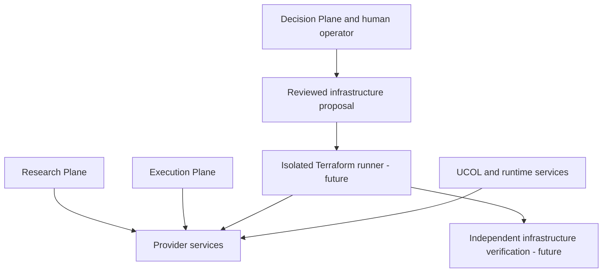

# Infrastructure Plane — Terraform adoption

Status: IP0 repository assessment and IP1a credential-free foundation proposed.
Baseline: main at 80c49ad6c6c01f6f665b839695b6f26135041a54.
No live cloud inventory, import, or production qualification has occurred.

## Architectural decision

Terraform is an operator-controlled management plane outside application request
handling. UCOL routes tasks; the Decision Plane governs authorization; Execution
owns dynamic workloads; Research verifies artifacts. Terraform manages durable
infrastructure only after explicit ownership transfer. No Terraform CLI, cloud
admin credential, or raw plan/state is exposed to Weaver, Relay, web routes,
desktop clients, customer workspaces, or model providers.

IP1a implements only the local validation fixture and its CI; the runner,
policy enforcement and verification arrows are target architecture, not live
integrations. User-facing latency and existing deployment mechanisms are unchanged.

## Repository-derived inventory and ownership

These are resource classes, not confirmed live resource IDs. Each must be
reconciled against provider APIs with read-only access before adoption.

| Domain | Repository evidence | Proposed Terraform scope | Retained owner / boundary |
| --- | --- | --- | --- |
| Vercel | vercel.json, .vercelignore | project settings and domains after provider qualification | Vercel application builds and deploy pipeline |
| Google Cloud / Firebase | firebase.json, .firebaserc, .github/workflows/deploy-cloud-run.yml | dedicated state bucket, IAM, durable storage and network resources | Firebase/Cloud Run release workflows and application data |
| Supabase | supabase/migrations | supported project-level settings after import | SQL migrations, RLS, data and application ownership |
| Upstash | DECISIONS.md rate limiting decision | durable Redis service configuration if supported | runtime cache and rate-limit keys |
| GitHub | .github/workflows | branch protection/settings after admin review | repository review and application CI/CD |
| GPU/self-hosted | infrastructure/README.md, docker-compose.lambda.yml | durable hosts and networking after inventory | existing Docker deployment and model serving |
| Account compute | lib/intelligence/execution/accountCompute, account-compute contract tests | dedicated network or host substrate only after qualification | account VM reservations, guest lifecycle, leases, suspension and teardown |
| Clerk, Trigger.dev, model APIs | vision.md, trigger.config.ts, provider adapters | defer until support and ownership verified | existing authentication, worker deployment, model routing and credential broker |

One writer per resource or field. Do not import resources managed by another
reconciler until ownership and rollback are documented. No provider IDs, tenant
identifiers or credentials belong in this public repository inventory.

## Adoption gates

| Phase | Deliverable | Exit gate |
| --- | --- | --- |
| IP0 | repository-derived assessment | live read-only inventory, owners, dependency graph and provider schema verification; not complete |
| IP1a | local Terraform contract fixture and CI | format, initialization, validate, plan-only tests pass |
| TF-1A.1P | provider economics and capability qualification | compare qualified total cost, VM isolation, resource controls, identity, state, residency, teardown and availability; no provider selected |
| IP1b | dedicated nonproduction remote state bootstrap | protected backend for selected provider, public access blocked, least privilege, lock contention and recovery test; explicit operator approval; GCS is one candidate |
| IP2 | import one low-risk nonproduction resource | import supported; no unintended create/update/delete/replace in reviewed plan; independent provider read |
| IP3 | reusable environment modules | isolated state, credentials, budget, deployment smoke checks |
| IP4 | governed plan/apply and drift | authenticated approval bound to exact saved plan digest, commit, state lineage/serial, target and expiry; destructive/unknown operations denied; independent receipt |
| IP5 | private compute/BYOC | network, isolation, residency, budget, cleanup and tenant tests |
| IP6 | GPU inference | quotas, private endpoint, artifact integrity, utilization and spend controls |
| IP7 | governed customer provisioning | separate per-customer trust boundary, lifecycle and authorization qualification |

## Future state and execution security

Separate root modules and backend identities by environment and trust boundary;
a Terraform workspace alone is not a security boundary. Bootstrap the state
backend separately, using a dedicated nonproduction project first. GCS is a
candidate, not provisioned. Require encryption, public access prevention, object
versioning, access auditing, recovery drills and state locking. State and saved
plans are sensitive: store only in restricted encrypted storage, never Git,
ordinary CI logs, public artifacts, or LLM context.

Use short-lived workload identities where supported. Plan and apply identities
are separated; no cloud credentials in pull-request CI. Future execution must
be isolated, with trusted pinned providers/modules and restricted egress.
Provider and module code can execute on initialization or planning; do not
evaluate arbitrary customer or model-generated HCL with privileged credentials.

Apply the exact approved saved plan once; reject stale, changed, unknown,
destructive, replacement or out-of-scope actions by default. Replan and obtain
fresh approval after drift, state change or expiry. No automatic production
apply or drift remediation. Human approvals and independent provider reads
are required. Git revert is not infrastructure rollback: use a newly approved
plan plus data backup/restore where applicable.

## First live pilot

After IP1a CI and IP0 live inventory are accepted, complete TF-1A.1P before
attaching a cloud account. Compare GCP, OCI and DigitalOcean using equivalent
qualified workloads, all-in costs (including storage, boot, idle, networking
and teardown), effective IAM, guest isolation, aggregate resource controls,
region/residency and capacity. Record observed evidence separately from
advertised features and prices. A cheap but unqualified provider is ineligible.
The selected backend and execution provider need not be the same; each trust
boundary and cost must be qualified independently.

#542 is the provider-neutral parent; #543 is the GCP candidate only. Keep a
single canonical GCS bootstrap, with other providers in separate roots. The
TF-1A/TF-1A.1 review packages are inputs for incremental reconciliation, not
accepted live configurations. Reconcile project IDs, state writer and execution
identity scopes, approved budgets and locked toolchains before live adoption.
Do not enable federation, create accounts or apply plans during comparison.
Once provider and spend are explicitly approved, demonstrate backend locking,
version recovery and independent resource read. No production resource is
imported before this pilot passes.
