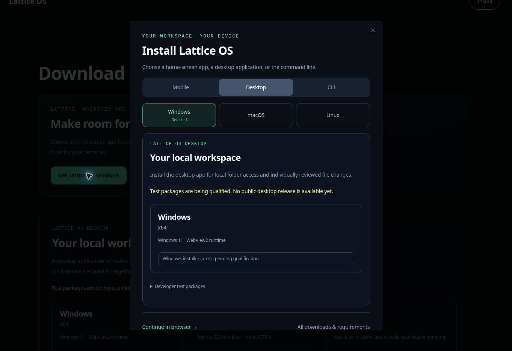

# Geräteabhängige Installation

Die Marketingnavigation und die Downloadseite öffnen einen gemeinsamen Installationsdialog. Er folgt dem Lattice-Design: dunkle Flächen, große Überschriften, smaragdgrüne Auswahlzustände und getrennte Plattformoptionen.

| Besucher | Erstauswahl |
| --- | --- |
| iPhone oder iPad, auch wenn iPadOS eine Desktopseite anfordert | Mobil → iPhone und iPad; Safari-Anleitung zum Startbildschirm |
| Android-Smartphone oder -Tablet | Mobil → Android; native Installationsschaltfläche nur nach `beforeinstallprompt`, sonst Anleitung über das Browsermenü |
| Windows-, macOS- oder Linux-Computer | Desktop → erkanntes Betriebssystem |
| ChromeOS oder unbekannter Computer | Manuelle Betriebssystemwahl; der Browser-Arbeitsbereich bleibt verfügbar |
| Unbekanntes Mobilgerät | Mobil mit manueller Wahl zwischen iPhone/iPad und Android |

Mobile Besucher von `/downloads` sehen die Auswahl einmal pro Browsersitzung. Im Standalone-/Minimal-UI-Modus oder nach `appinstalled` erscheint keine automatische Aufforderung. Ein ausdrücklicher Klick auf Installieren öffnet sie immer. Wenn Speicherung verweigert wird, erfolgt die Aufforderung nur einmal pro Lebensdauer des Providers. Die Erkennung empfiehlt lediglich eine Option: Sie leitet nicht weiter, startet keinen Download und wählt keine Prozessorarchitektur.

`beforeinstallprompt` wird von einem einzigen Layout-Provider erfasst und nur nach einem ausdrücklichen Installieren-Klick verwendet. Annahme, Ablehnung, Fehler und `appinstalled` aktualisieren die Oberfläche; ein verbrauchtes Ereignis lässt sich nicht wiederverwenden. iOS nutzt manuelle Safari-Schritte. Die Startbildschirm-App bietet die Webfunktionen; diese Änderung liefert weder Offline-Inferenz noch eine APK.

Das öffentliche `/lattice.webmanifest` beschreibt eine stabile App-Identität, `/dashboard` als Startadresse, Standalone-Darstellung und echte PNG-Dateien mit 192/512 Pixeln. Die bestehende Proxy-Regel schließt Manifest-Endung und Icon-URLs aus. Es wurden weder Authentifizierungsausnahmen noch neue Service Worker oder ein Cache für authentifizierte Antworten eingeführt.

Die Desktop-Panels werden weiterhin serverseitig von `DesktopDownloads` gerendert, Terminal-Panels von `TerminalInstall`. Beide nutzen unabhängig geprüfte Release-Kataloge. Leere Kataloge zeigen einen ausstehenden Status statt Binärdateien oder ausführbarer Installationsbefehle. Nach CLI-Qualifizierung bietet das Terminal getrennte Bereiche für Download-/Herkunftsprüfung, Skriptinspektion und versions-/commitgebundene Ausführung.

Abgeschlossene Prüfungen:

- 48 Tests für Geräteerkennung und Installationszyklus, Manifest-/Icon-Anforderungen, Release-Kataloge und öffentliche Downloadrouten.
- Vollständiger `pnpm typecheck` und gezielte Typprüfung von `desktop/tsconfig.downloads.json`.
- Chromium-Oberflächentests für Windows-Auswahl, iOS-Anweisungen bei 390 × 844, manuelle Linux-/CLI-Auswahl, Sitzungsunterdrückung, Unterdrückung auf installiertem iPad, Escape-/Fokuswiederherstellung und Tastaturfokusbegrenzung.
- Ein simuliertes Android-Installationsereignis aktiviert die native Aktion; nach Annahme wird sie entfernt und Lattice öffnen angeboten. Lebenszyklustests prüfen auch Schließen, Ablehnung und einmalige Verwendung.

Die Browsertests nutzten echte Anwendungskomponenten mit simulierten Geräteidentitäten in einer isolierten Vorschau. Der verwaltete Vorschau-Starter übergab nicht unterstützte Flags an Next.js; die vollständige authentifizierte App wurde daher nicht im Browser getestet. Eine echte Safari-/Android-Installation und der Abruf des bereitgestellten Manifests müssen nach der Veröffentlichung auf Geräten geprüft werden. Daraus folgt keine Freigabe eines nativen Releases.

Browserreferenzen: [Apple-Installation auf dem Startbildschirm](https://support.apple.com/guide/iphone/open-as-web-app-iphea86e5236/27/ios/27), [MDN-Installationsaufforderung](https://developer.mozilla.org/en-US/docs/Web/Progressive_web_apps/How_to/Trigger_install_prompt), [MDN-Installierbarkeitsanforderungen](https://developer.mozilla.org/en-US/docs/Web/Progressive_web_apps/Guides/Making_PWAs_installable).
