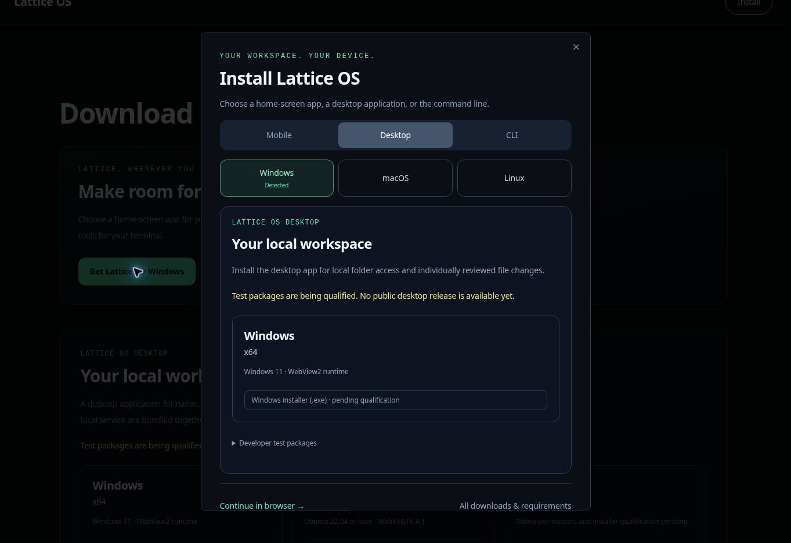

# Instalación adaptada al dispositivo

La navegación de marketing y la página de descargas abren el mismo selector de instalación. Su diseño sigue el estilo de descargas de Lattice: superficies oscuras, títulos grandes, estados de selección esmeralda y opciones diferenciadas por plataforma.

| Visitante | Selección inicial |
| --- | --- |
| iPhone o iPad, incluido iPadOS con solicitud de sitio de escritorio | Móvil → iPhone y iPad; instrucciones de Safari para la pantalla de inicio |
| Teléfono o tableta Android | Móvil → Android; botón de instalación nativa solo después de `beforeinstallprompt`; de lo contrario, instrucciones del menú del navegador |
| Equipo Windows, macOS o Linux | Escritorio → sistema operativo detectado |
| ChromeOS u otro equipo desconocido | Selección manual del sistema operativo; el espacio de trabajo web sigue disponible |
| Dispositivo móvil desconocido | Móvil con selección manual de iPhone/iPad o Android |

Los visitantes móviles de `/downloads` ven el selector una vez por sesión del navegador. El modo standalone/minimal-ui o el evento `appinstalled` suprimen la apertura automática. Al pulsar explícitamente Instalar, el selector siempre se abre. Si se deniega el almacenamiento, se muestra una vez por vida del proveedor. La detección solo recomienda; nunca redirige, inicia una descarga ni elige la arquitectura del procesador.

Un único proveedor de diseño captura `beforeinstallprompt`, que solo se consume tras pulsar Instalar. La aceptación, el rechazo, los errores y `appinstalled` actualizan la interfaz; un evento consumido no se reutiliza. iOS utiliza instrucciones manuales de Safari. La app de pantalla de inicio conserva las capacidades web; este cambio no añade inferencia sin conexión ni distribuye un APK.

El `/lattice.webmanifest` público declara una identidad de aplicación estable, `/dashboard` como URL de inicio, visualización independiente y PNG reales de 192/512 píxeles. El matcher del proxy ya excluye su extensión y las URL de iconos. No se añadió ninguna excepción de autenticación, servicio worker nuevo ni caché de respuestas autenticadas.

Los paneles de escritorio siguen renderizados en el servidor mediante `DesktopDownloads`, y los de terminal mediante `TerminalInstall`. Ambos usan catálogos de versiones validados por separado. Un catálogo nulo muestra un estado pendiente, no binarios ni comandos ejecutables de instalación. Tras validar la CLI, el panel de terminal ofrece bloques separados para descarga/verificación de procedencia, inspección de scripts y ejecución fijada a versión y commit.

Validaciones completadas:

- 48 pruebas de detección y ciclo de instalación, requisitos de manifiesto e iconos, catálogos de versiones y rutas públicas de descarga.
- Comprobación completa `pnpm typecheck` y comprobación específica `desktop/tsconfig.downloads.json`.
- Pruebas de interfaz con Chromium: Windows, instrucciones de iOS a 390 × 844, selección manual de Linux/CLI, supresión por sesión e iPad instalado, restauración del foco/Escape y contención del foco del teclado.
- Un evento simulado de instalación Android habilita la acción nativa; su aceptación la desactiva y presenta Abrir Lattice. Las pruebas del ciclo también cubren descarte, rechazo y uso único.

Las pruebas del navegador usaron componentes reales con identidades de dispositivo simuladas en un entorno aislado. El iniciador de vista previa gestionado pasó argumentos no admitidos a Next.js, por lo que no se probó toda la aplicación autenticada en el navegador. La instalación real de Safari/Android y la descarga del manifiesto desplegado siguen requiriendo una prueba en dispositivo tras publicar. Esto no acredita una versión nativa.

Referencias de comportamiento: [instalar en la pantalla de inicio de Apple](https://support.apple.com/guide/iphone/open-as-web-app-iphea86e5236/27/ios/27), [solicitud de instalación MDN](https://developer.mozilla.org/en-US/docs/Web/Progressive_web_apps/How_to/Trigger_install_prompt), [requisitos de instalación MDN](https://developer.mozilla.org/en-US/docs/Web/Progressive_web_apps/Guides/Making_PWAs_installable).
