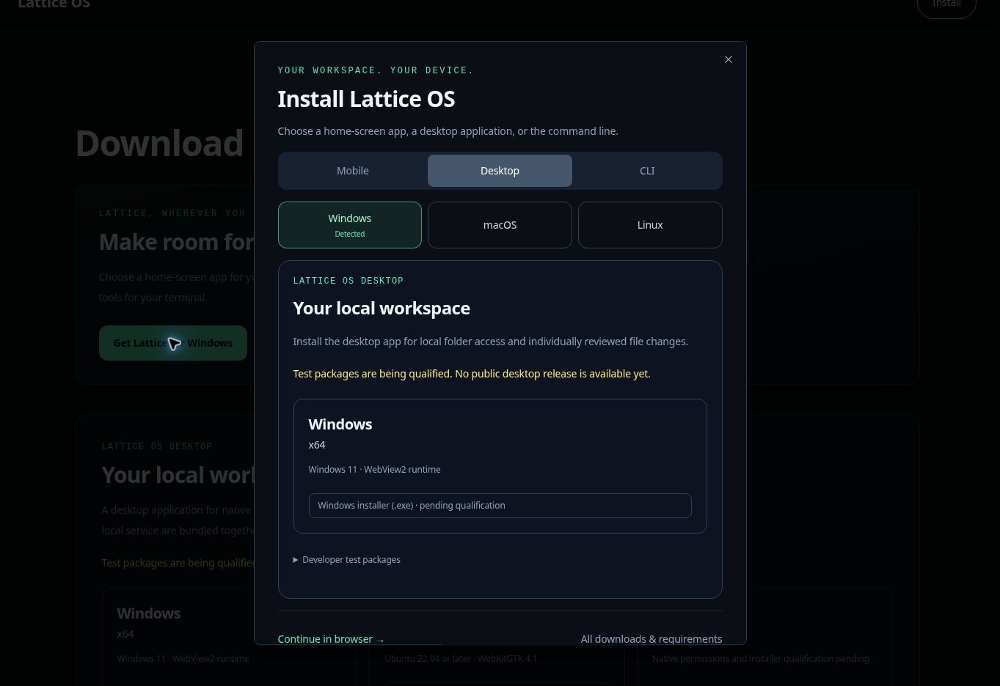

# Installation adaptée à l'appareil

La navigation marketing et la page Téléchargements ouvrent un même sélecteur d'installation. Son apparence reprend le design des téléchargements Lattice : fonds sombres, grands titres, états de sélection émeraude et choix de plateformes distincts.

| Visiteur | Sélection initiale |
| --- | --- |
| iPhone ou iPad, y compris iPadOS demandant la version ordinateur d'un site | Mobile → iPhone et iPad ; instructions Safari pour l'écran d'accueil |
| Téléphone ou tablette Android | Mobile → Android ; bouton d'installation native seulement après `beforeinstallprompt`, sinon instructions du menu du navigateur |
| Ordinateur Windows, macOS ou Linux | Ordinateur → système d'exploitation détecté |
| ChromeOS ou ordinateur inconnu | Sélection manuelle du système ; l'espace de travail web reste disponible |
| Appareil mobile inconnu | Mobile, avec sélection manuelle iPhone/iPad ou Android |

Les visiteurs mobiles de `/downloads` voient le sélecteur une fois par session de navigateur. Le mode standalone/minimal-ui ou l'événement `appinstalled` désactivent l'invite automatique. Un clic explicite sur Installer ouvre toujours le sélecteur. Si le stockage est refusé, la présentation est limitée à une fois par durée de vie du fournisseur. La détection ne fait que recommander : elle ne redirige jamais, ne lance pas de téléchargement et ne choisit pas l'architecture du processeur.

Un fournisseur de mise en page unique capture `beforeinstallprompt`, utilisé uniquement après un clic explicite sur Installer. Acceptation, refus, erreurs et `appinstalled` actualisent l'interface ; un événement consommé ne peut pas être réutilisé. iOS utilise les instructions manuelles de Safari. L'application d'écran d'accueil conserve les capacités web ; ce changement ne fournit ni inférence hors ligne ni APK.

Le fichier public `/lattice.webmanifest` déclare une identité stable, `/dashboard` comme URL de démarrage, un affichage autonome et de véritables PNG de 192/512 pixels. Son extension et les URL d'icônes sont exclus par le matcher de proxy existant. Aucune exemption d'authentification, aucun nouveau service worker ni cache de réponses authentifiées n'a été introduit.

Les panneaux de bureau restent rendus côté serveur par `DesktopDownloads`, et ceux du terminal par `TerminalInstall`. Tous deux utilisent les catalogues de publication validés indépendamment. Un catalogue nul affiche un état en attente plutôt que des binaires ou des commandes exécutables. Après qualification de la CLI, le panneau terminal fournit séparément téléchargement/vérification de provenance, inspection du script et exécution épinglée à une version et un commit.

Validation effectuée :

- 48 tests de détection et cycle de l'installation, du manifeste/des icônes, des catalogues de publication et des routes publiques de téléchargement.
- Vérification complète `pnpm typecheck` et vérification ciblée `desktop/tsconfig.downloads.json`.
- Tests d'interface Chromium : choix Windows, instructions iOS en 390 × 844, sélection manuelle Linux/CLI, suppression par session et sur iPad installé, restauration du focus par Échap, confinement du focus clavier.
- Un événement Android simulé autorise l'installation native ; son acceptation efface l'action et propose Ouvrir Lattice. Les tests de cycle couvrent aussi fermeture, refus et utilisation unique.

Les tests ont utilisé des composants réels avec des identités d'appareil simulées dans un aperçu isolé. Le lanceur d'aperçu géré a transmis des options non prises en charge à Next.js ; l'application authentifiée complète n'a donc pas été testée dans le navigateur. Les installations Safari/Android réelles et la récupération du manifeste déployé nécessitent encore un test sur appareil après déploiement. Cela ne vaut pas qualification d'une version native.

Références du comportement navigateur : [installation Apple sur l'écran d'accueil](https://support.apple.com/guide/iphone/open-as-web-app-iphea86e5236/27/ios/27), [invite d'installation MDN](https://developer.mozilla.org/en-US/docs/Web/Progressive_web_apps/How_to/Trigger_install_prompt), [exigences d'installation MDN](https://developer.mozilla.org/en-US/docs/Web/Progressive_web_apps/Guides/Making_PWAs_installable).
