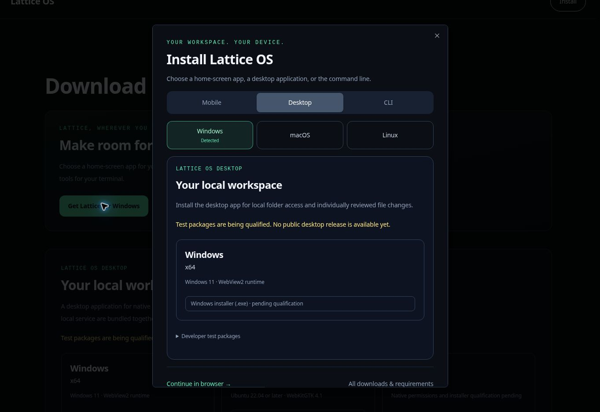

# Device-aware installation

The marketing navigation and Downloads page open one installation chooser. Its presentation follows the existing Lattice download design: dark surfaces, large headings, emerald selection states and separate platform choices.

| Visitor | Initial selection |
| --- | --- |
| iPhone or iPad, including iPadOS requesting a desktop site | Mobile → iPhone & iPad; Safari home-screen instructions |
| Android phone or tablet | Mobile → Android; native install button only after `beforeinstallprompt`, otherwise browser menu instructions |
| Windows, macOS or Linux computer | Desktop → detected operating system |
| ChromeOS or an unknown computer | Manual operating-system selection; browser workspace remains available |
| Unknown mobile device | Mobile with manual iPhone/iPad or Android selection |

Mobile visitors to `/downloads` see the chooser once per browser session. Running in standalone/minimal-ui mode or receiving `appinstalled` suppresses automatic prompting. An explicit Install click always opens the chooser. Storage denial falls back to once per provider lifetime. Detection selects a recommendation; it never redirects, initiates a download or chooses a processor architecture.

`beforeinstallprompt` is captured by one layout provider and consumed only from an explicit Install click. Acceptance, dismissal, errors and `appinstalled` update the UI; a consumed event cannot be reused. iOS uses manual Safari instructions. The home-screen app retains the web product's capabilities; this change does not implement offline inference or distribute an APK.

The public `/lattice.webmanifest` declares stable app identity, `/dashboard` as the launch URL, standalone display and actual 192/512-pixel PNGs. Its extension and icon URLs are excluded by the existing proxy matcher. No authentication exemption was added. No new service worker or authenticated-response caching was introduced.

Desktop panels remain server-rendered through `DesktopDownloads`, and terminal panels through `TerminalInstall`. Both use the existing independently validated release catalogs. Null catalogs expose pending status rather than binaries or executable installation commands. After CLI qualification, the terminal panel offers separate download/provenance verification, script inspection and version/source-pinned execution blocks.

Validation completed:

- 48 tests across installation detection/lifecycle, manifest/icon requirements, release catalogs and public download routes.
- Full `pnpm typecheck` and focused `desktop/tsconfig.downloads.json` typecheck.
- Chromium UI checks of Windows selection, iOS instructions at 390 × 844, manual Linux/CLI selection, session suppression, installed iPad suppression, Escape/focus restoration and keyboard focus containment.
- A simulated Android installability event enables the native action; accepting the simulated installation clears it and presents Open Lattice. The lifecycle tests also exercise dismissal, rejection and single-use behavior.

The browser checks used actual application components with simulated device identities in an isolated preview. The managed preview launcher supplied unsupported flags to Next.js, so the complete authenticated Next.js app was not exercised in the browser. Real Safari/Android installation and a deployed manifest fetch still require a device smoke test after deployment. No native release qualification is implied.

Browser behavior references: [Apple home-screen installation](https://support.apple.com/guide/iphone/open-as-web-app-iphea86e5236/27/ios/27), [MDN installation prompting](https://developer.mozilla.org/en-US/docs/Web/Progressive_web_apps/How_to/Trigger_install_prompt), [MDN installability requirements](https://developer.mozilla.org/en-US/docs/Web/Progressive_web_apps/Guides/Making_PWAs_installable).
