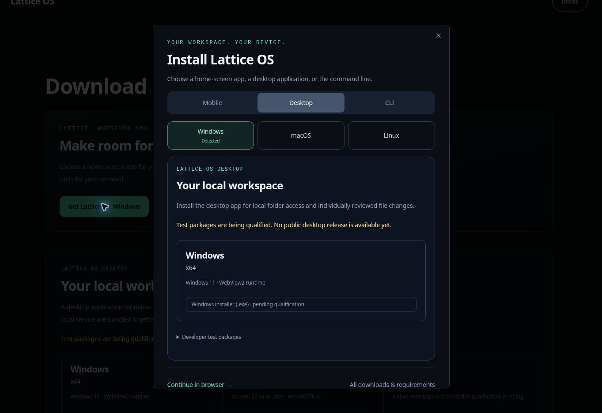

# การติดตั้งตามประเภทอุปกรณ์

เมนูเว็บไซต์และหน้าดาวน์โหลดเปิดตัวเลือกการติดตั้งเดียวกัน รูปแบบยังคงใช้ดีไซน์ดาวน์โหลดของ Lattice คือพื้นหลังสีเข้ม หัวข้อขนาดใหญ่ สถานะการเลือกสีเขียวมรกต และตัวเลือกแยกตามแพลตฟอร์ม

| ผู้เข้าชม | ตัวเลือกเริ่มต้น |
| --- | --- |
| iPhone หรือ iPad รวมทั้ง iPadOS ที่ขอแสดงเว็บไซต์แบบเดสก์ท็อป | มือถือ → iPhone และ iPad; ขั้นตอนเพิ่มลงหน้าจอหลักผ่าน Safari |
| โทรศัพท์หรือแท็บเล็ต Android | มือถือ → Android; ปุ่มติดตั้งโดยตรงจะแสดงหลัง `beforeinstallprompt` เท่านั้น หากไม่มีให้ใช้คำแนะนำในเมนูเบราว์เซอร์ |
| คอมพิวเตอร์ Windows, macOS หรือ Linux | เดสก์ท็อป → ระบบปฏิบัติการที่ตรวจพบ |
| ChromeOS หรือคอมพิวเตอร์ที่ไม่รู้จัก | เลือกระบบปฏิบัติการด้วยตนเอง; เวิร์กสเปซผ่านเบราว์เซอร์ยังใช้งานได้ |
| อุปกรณ์มือถือที่ไม่รู้จัก | มือถือ โดยเลือก iPhone/iPad หรือ Android ด้วยตนเอง |

ผู้เข้าชม `/downloads` บนมือถือจะเห็นตัวเลือกหนึ่งครั้งต่อเซสชันของเบราว์เซอร์ การใช้งานแบบ standalone/minimal-ui หรือเหตุการณ์ `appinstalled` จะปิดการแจ้งเตือนอัตโนมัติ แต่การกดติดตั้งเองจะเปิดตัวเลือกทุกครั้ง หากไม่อนุญาตให้จัดเก็บข้อมูล ระบบจะถามเพียงหนึ่งครั้งต่ออายุของผู้ให้บริการ การตรวจจับแค่แนะนำตัวเลือก ไม่เปลี่ยนเส้นทาง ไม่เริ่มดาวน์โหลด และไม่เลือกสถาปัตยกรรมซีพียู

ผู้ให้บริการเลย์เอาต์หนึ่งตัวจับเหตุการณ์ `beforeinstallprompt` และใช้ได้เมื่อกดติดตั้งอย่างชัดเจนเท่านั้น การยอมรับ การยกเลิก ข้อผิดพลาด และ `appinstalled` จะอัปเดตหน้า UI; เหตุการณ์ที่ใช้แล้วจะนำมาใช้ซ้ำไม่ได้ iOS ใช้คำแนะนำ Safari แบบทำเอง แอปที่เพิ่มบนหน้าจอหลักยังมีความสามารถของเว็บ ไม่ได้เพิ่มการอนุมานแบบออฟไลน์หรือแจกจ่าย APK

ไฟล์สาธารณะ `/lattice.webmanifest` ระบุตัวตนแอปที่คงที่ ใช้ `/dashboard` เป็นหน้าเริ่มต้น แสดงแบบ standalone และใช้ PNG จริงขนาด 192/512 พิกเซล กฎพร็อกซีเดิมยกเว้นส่วนขยายและ URL ไอคอนแล้ว ไม่มีการยกเว้นการยืนยันตัวตน เพิ่ม service worker ใหม่ หรือแคชคำตอบที่ต้องเข้าสู่ระบบ

แผงเดสก์ท็อปยังเรนเดอร์ฝั่งเซิร์ฟเวอร์ผ่าน `DesktopDownloads` และแผงเทอร์มินัลผ่าน `TerminalInstall` ทั้งคู่ใช้แค็ตตาล็อกการเผยแพร่ที่ตรวจสอบแยกกัน หากแค็ตตาล็อกว่างจะแสดงสถานะรอดำเนินการแทนไบนารีหรือคำสั่งติดตั้งที่รันได้ เมื่อ CLI ผ่านการตรวจสอบ แผงเทอร์มินัลจะแยกขั้นตอนดาวน์โหลด/ตรวจสอบที่มา ตรวจสอบสคริปต์ และเรียกใช้โดยล็อกเวอร์ชันกับ commit

การตรวจสอบที่เสร็จสิ้น:

- ทดสอบ 48 รายการเกี่ยวกับการตรวจจับอุปกรณ์ วงจรการติดตั้ง ข้อกำหนด manifest/ไอคอน แค็ตตาล็อกการเผยแพร่ และเส้นทางดาวน์โหลดสาธารณะ
- รัน `pnpm typecheck` ทั้งหมด และตรวจชนิดข้อมูลเฉพาะ `desktop/tsconfig.downloads.json`
- ทดสอบ UI ด้วย Chromium: การเลือก Windows คำแนะนำ iOS ที่ 390 × 844 การเลือก Linux/CLI ด้วยตนเอง การระงับตามเซสชันและบน iPad ที่ติดตั้งแล้ว การคืนโฟกัสด้วย Escape และการจำกัดโฟกัสจากคีย์บอร์ด
- เหตุการณ์จำลองการติดตั้ง Android เปิดใช้คำสั่งติดตั้งโดยตรง เมื่อยอมรับจะล้างเหตุการณ์และแสดง เปิด Lattice การทดสอบวงจรยังครอบคลุมการยกเลิก การปฏิเสธ และใช้ได้ครั้งเดียว

การทดสอบเบราว์เซอร์ใช้คอมโพเนนต์จริงกับอุปกรณ์จำลองในพรีวิวที่แยกไว้ โปรแกรมเปิดพรีวิวที่จัดการโดยระบบส่งแฟล็กที่ Next.js ไม่รองรับ จึงไม่ได้ทดสอบแอปที่เข้าสู่ระบบครบทั้งหมดในเบราว์เซอร์ การติดตั้งจริงบน Safari/Android และการดึง manifest จากระบบที่เผยแพร่ยังต้องทดสอบบนอุปกรณ์หลัง deploy ไม่มีหลักฐานว่าผ่านการรับรองรุ่น native

อ้างอิงพฤติกรรมเบราว์เซอร์: [การติดตั้งบนหน้าจอหลัก Apple](https://support.apple.com/guide/iphone/open-as-web-app-iphea86e5236/27/ios/27), [คำขอติดตั้ง MDN](https://developer.mozilla.org/en-US/docs/Web/Progressive_web_apps/How_to/Trigger_install_prompt), [ข้อกำหนดการติดตั้ง MDN](https://developer.mozilla.org/en-US/docs/Web/Progressive_web_apps/Guides/Making_PWAs_installable).
