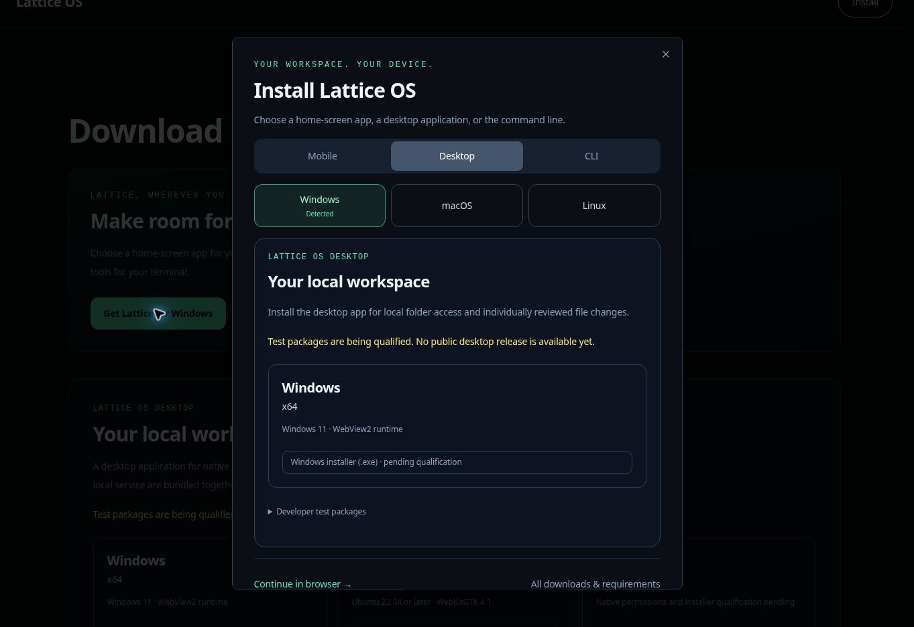

# Cài đặt phù hợp với thiết bị

Thanh điều hướng và trang Tải xuống mở cùng một bộ chọn cài đặt. Giao diện dùng thiết kế tải xuống Lattice: nền tối, tiêu đề lớn, trạng thái lựa chọn màu ngọc lục bảo và tùy chọn riêng cho từng nền tảng.

| Người truy cập | Lựa chọn ban đầu |
| --- | --- |
| iPhone hoặc iPad, kể cả iPadOS yêu cầu trang web dành cho máy tính | Di động → iPhone và iPad; hướng dẫn Safari thêm vào màn hình chính |
| Điện thoại hoặc máy tính bảng Android | Di động → Android; chỉ hiện nút cài đặt gốc sau `beforeinstallprompt`, nếu không hãy dùng hướng dẫn trong menu trình duyệt |
| Máy tính Windows, macOS hoặc Linux | Máy tính → hệ điều hành được phát hiện |
| ChromeOS hoặc máy tính không nhận diện | Chọn hệ điều hành thủ công; không gian làm việc trên trình duyệt vẫn khả dụng |
| Thiết bị di động không nhận diện | Di động với lựa chọn iPhone/iPad hoặc Android thủ công |

Người dùng di động vào `/downloads` thấy bộ chọn một lần mỗi phiên trình duyệt. Chế độ standalone/minimal-ui hoặc sự kiện `appinstalled` sẽ ngăn nhắc tự động. Nhấp Cài đặt trực tiếp luôn mở bộ chọn. Nếu lưu trữ bị từ chối, bộ chọn chỉ xuất hiện một lần trong vòng đời nhà cung cấp. Phát hiện thiết bị chỉ đưa ra gợi ý; không tự chuyển hướng, tải xuống hay chọn kiến trúc bộ xử lý.

Một nhà cung cấp bố cục ghi nhận `beforeinstallprompt` và chỉ sử dụng khi người dùng nhấp Cài đặt rõ ràng. Chấp nhận, đóng, lỗi và `appinstalled` cập nhật giao diện; sự kiện đã sử dụng không thể dùng lại. iOS dùng hướng dẫn Safari thủ công. Ứng dụng trên màn hình chính vẫn có khả năng của phiên bản web; thay đổi này không triển khai suy luận ngoại tuyến hoặc phân phối APK.

Tệp công khai `/lattice.webmanifest` khai báo danh tính ứng dụng ổn định, dùng `/dashboard` làm URL khởi chạy, hiển thị độc lập và hình PNG 192/512 pixel thực. Bộ lọc proxy hiện có loại trừ phần mở rộng và URL biểu tượng. Không thêm ngoại lệ xác thực, service worker mới hay lưu bộ nhớ đệm các phản hồi đã xác thực.

Các bảng điều khiển máy tính vẫn được kết xuất phía máy chủ qua `DesktopDownloads`, bảng điều khiển dòng lệnh qua `TerminalInstall`. Cả hai sử dụng danh mục phát hành được kiểm tra độc lập. Danh mục trống hiển thị trạng thái chờ thay vì nhị phân hay lệnh cài đặt có thể chạy. Sau khi CLI được kiểm định, bảng điều khiển dòng lệnh cung cấp riêng phần tải xuống/xác minh nguồn gốc, kiểm tra tập lệnh và thực thi cố định phiên bản/commit.

Kiểm tra đã hoàn tất:

- 48 bài kiểm tra về phát hiện thiết bị/vòng đời cài đặt, yêu cầu manifest/biểu tượng, danh mục phát hành và tuyến tải xuống công khai.
- Kiểm tra kiểu dữ liệu toàn bộ bằng `pnpm typecheck` và kiểm tra riêng `desktop/tsconfig.downloads.json`.
- Kiểm tra giao diện Chromium: chọn Windows, hướng dẫn iOS ở 390 × 844, chọn Linux/CLI thủ công, ngăn thông báo trong phiên và trên iPad đã cài, khôi phục focus bằng Escape và giới hạn focus bàn phím.
- Sự kiện Android giả lập kích hoạt hành động cài đặt gốc; khi chấp nhận, sự kiện được xóa và hiển thị Mở Lattice. Kiểm tra vòng đời cũng bao gồm đóng, từ chối và chỉ sử dụng một lần.

Kiểm tra trình duyệt sử dụng các thành phần ứng dụng thật với danh tính thiết bị mô phỏng trong bản xem trước cách ly. Trình khởi chạy bản xem trước được quản lý truyền cờ không được Next.js hỗ trợ, vì vậy ứng dụng đầy đủ đã xác thực chưa được chạy thử trong trình duyệt. Cài đặt Safari/Android thực tế và tải manifest đã triển khai vẫn cần kiểm tra trên thiết bị sau phát hành. Điều này không đồng nghĩa với việc đạt chuẩn phát hành ứng dụng gốc.

Tham khảo hành vi trình duyệt: [cài đặt vào màn hình chính Apple](https://support.apple.com/guide/iphone/open-as-web-app-iphea86e5236/27/ios/27), [yêu cầu cài đặt MDN](https://developer.mozilla.org/en-US/docs/Web/Progressive_web_apps/How_to/Trigger_install_prompt), [yêu cầu hỗ trợ cài đặt MDN](https://developer.mozilla.org/en-US/docs/Web/Progressive_web_apps/Guides/Making_PWAs_installable).
